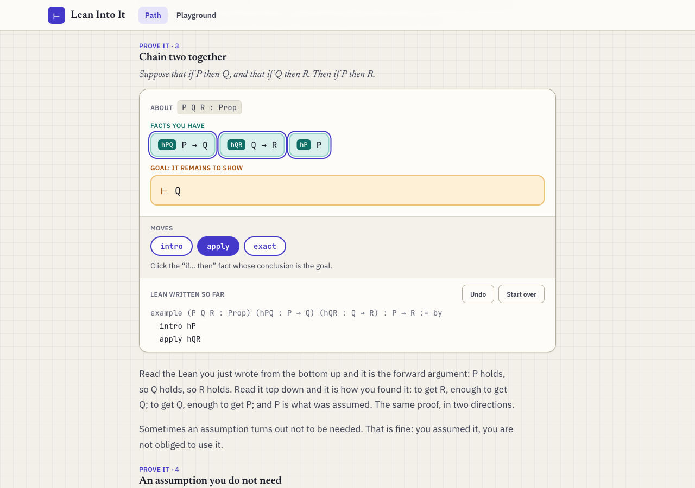
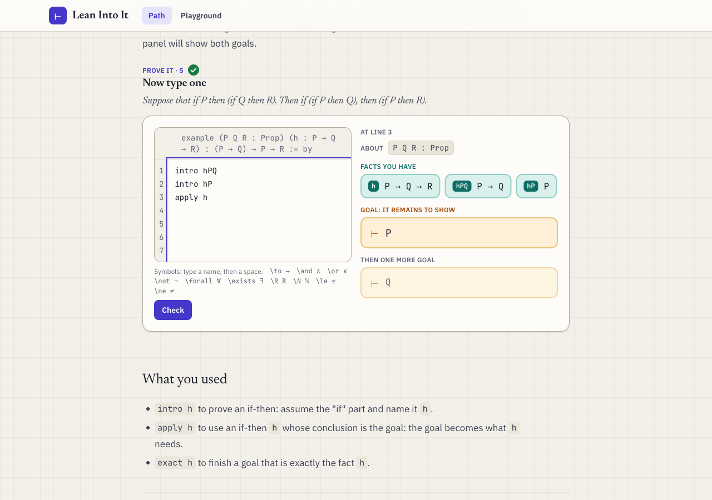
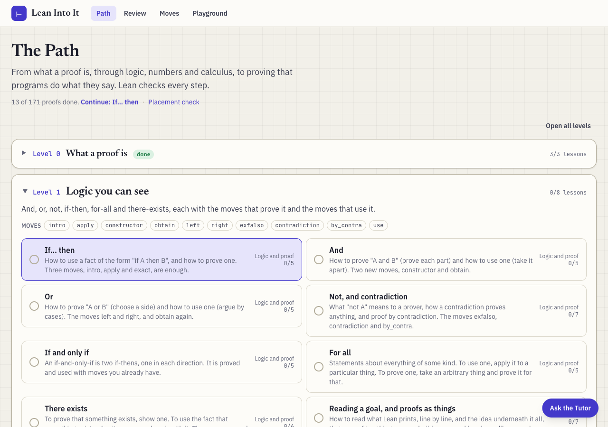
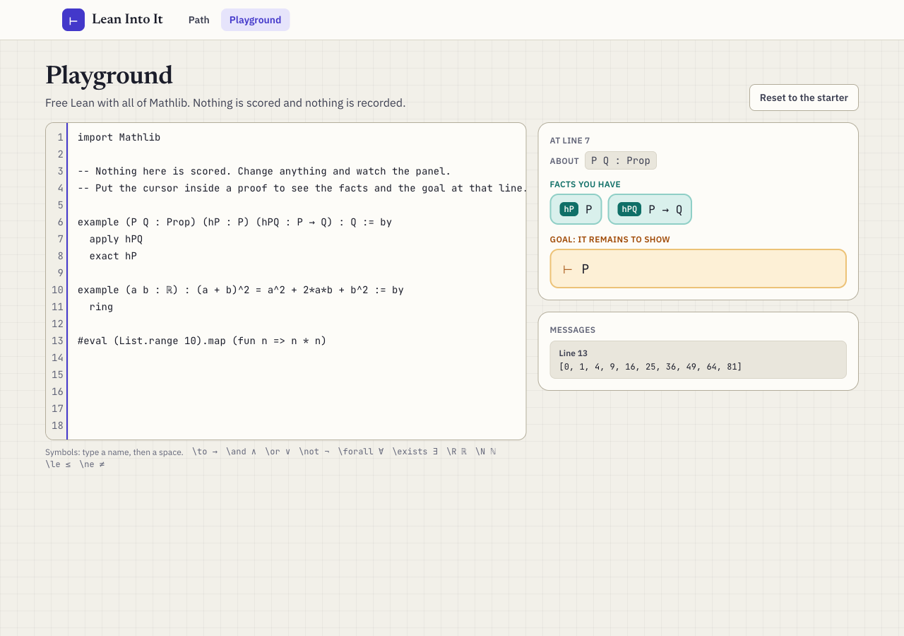

<h1 align="center">Lean Into It</h1>

<p align="center"><b>A visual app for learning mathematical proof and formal verification with Lean 4.</b></p>
<p align="center">Logic, induction, algebra and verified programs. Every idea is shown, built by hand, and checked by a real proof assistant.</p>

<p align="center">
  
  
  
  
  <a href="LICENSE"></a>
  
</p>

<p align="center">
  
  <br>
  <sub><i>Facts in, moves applied, goal closed, and Lean agrees.</i></sub>
</p>

## Features

This is an early build. The first four features below work today; the last two are planned. [`docs/STATUS.md`](docs/STATUS.md) lists what is done and what remains.

<table>
  <tr>
    <td width="50%" valign="top">
      
      <br><sub><i>The proof board: click a move, watch the goal change.</i></sub>
      <h3>Click-to-prove proof board</h3>
      <p>Hypotheses and the goal are cards, and moves are buttons. Each click writes one line of real Lean, shown under the board as it grows, and Lean reports the new goal.</p>
    </td>
    <td width="50%" valign="top">
      
      <br><sub><i>The same proof, typed, with the goal state beside it.</i></sub>
      <h3>Typed Lean with a live goal panel</h3>
      <p>An editor with the current hypotheses and goals next to it, updated as you type. Exercises are graded by Lean: an error or a <code>sorry</code> fails, and nothing else decides.</p>
    </td>
  </tr>
  <tr>
    <td width="50%" valign="top">
      
      <br><sub><i>The Path: nine levels, from what a proof is to how large formalisations are built.</i></sub>
      <h3>A guided path</h3>
      <p>Levels 0 to 8 in four linked tracks: logic and proof, a maths refresher towards calculus, Lean itself, and verified programs. Level 0 and one Level 1 lesson are written so far; the rest are outlined. Completed exercises and lessons are recorded.</p>
    </td>
    <td width="50%" valign="top">
      
      <br><sub><i>The Playground: Lean and Mathlib, nothing scored.</i></sub>
      <h3>Playground</h3>
      <p>A Lean file of your own with all of Mathlib behind it and the same goal panel. Try an idea, break it, and read what Lean says.</p>
    </td>
  </tr>
  <tr>
    <td width="50%" valign="top">
      <h3>Live proof map (planned)</h3>
      <p>A diagram that grows as you prove: facts as nodes, moves as arrows, open goals highlighted. With it come function and limit explorers, textbook proofs set beside their Lean, and a program stepper.</p>
    </td>
    <td width="50%" valign="top">
      <h3>A Tutor (planned)</h3>
      <p>An embedded Claude agent that sees your goal state and the last error, gives hints one rung at a time, works alongside you in the Playground, and writes new lessons whose exercises must compile in Lean before they land. It never grades.</p>
    </td>
  </tr>
</table>

Also planned: mastery and spaced review, a placement check, three more exercise kinds, Listen mode (read-aloud), a Lab with a gallery of famous proofs, and a Dock app.

## How it works

Localhost, one learner, no login. The curriculum is markdown and YAML in `content/`, tracked by git. Lean 4 and Mathlib live in the Lake project under `lean/`; the dev server keeps one Lean language server running and sends it each proof, so a check returns the same goal states and messages Lean would show in an editor. For an exercise the server supplies the statement and wraps your proof in it, and Lean alone decides whether it passes. Attempts and completion are rows in a local Postgres database.

Lean runs what you type with your own permissions, so the API accepts same-origin requests from localhost only. This is a tool for your own machine, not something to host.

## Get started

Needs Node, Postgres 17 and the Lean version manager:

```sh
brew install elan-init
brew install postgresql@17 && brew services start postgresql@17
```

Then:

```sh
npm install && npm --prefix web install
npm run lean:setup          # once: Lean 4 toolchain and the Mathlib build cache
npm run db:setup            # once per machine: creates the lean_into_it database and migrates it
npm run dev                 # http://localhost:38800
```

`lean:setup` downloads about 7 GB into `lean/.lake` and about 3 GB of toolchain into `~/.elan`. The first proof check after starting the server takes a while, as Lean loads Mathlib; later checks are quick.

## Development

```sh
npm test                    # node --test: database tests on an in-process PGlite, proof tests on the real Lean
npm run typecheck
npm run lint
```

- [`docs/PRD.md`](docs/PRD.md): what it is and what was decided.
- [`docs/STATUS.md`](docs/STATUS.md): what is done and what remains, by bead.
- [`docs/CONTENT.md`](docs/CONTENT.md): how lessons and exercises are written.
- [`CLAUDE.md`](CLAUDE.md): layout and rules for agents working on the code.

Work is tracked with beads (`bd ready`, prefix `lii`).

## Credits

Proofs are checked by [Lean 4](https://lean-lang.org) with [Mathlib](https://github.com/leanprover-community/mathlib4), both under the Apache License 2.0. They are fetched at install time and are not bundled in this repository.

## License

[GNU Affero General Public License v3.0](LICENSE) (AGPL-3.0-only). You may use, change and share Lean Into It, but if you distribute it or run a changed version as a network service, you must offer its users the complete source under the same license.

This covers the code and the lessons under `content/`. Lean and Mathlib keep their own licences, listed under Credits.
